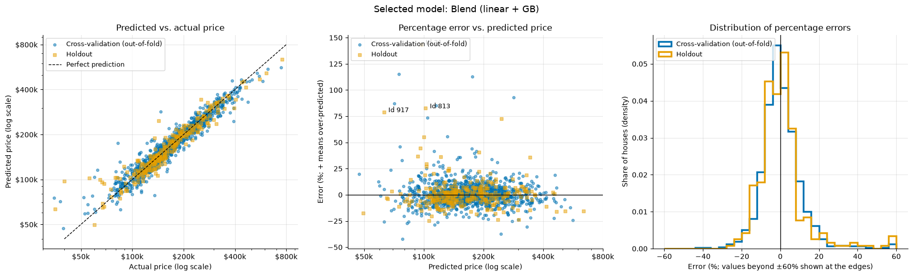
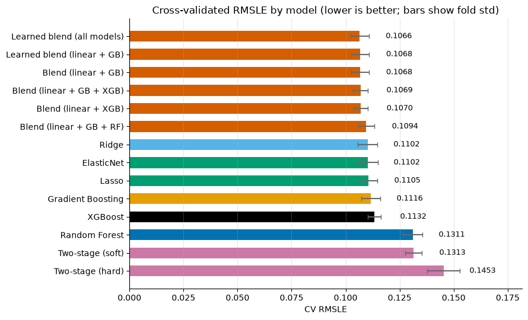

# House Price Prediction (Kaggle: House Prices – Advanced Regression Techniques)

Predicting the sale prices of houses in Ames, Iowa, from 79 descriptive features: an end-to-end regression project, from raw CSV files to a Kaggle submission.

| Measure | Random Forest baseline | Final model |
|---|---|---|
| 5-fold CV RMSLE | 0.1311 | **0.1054** |
| Holdout RMSLE (20%, used once) | 0.1451 | **0.1273** |
| Kaggle public leaderboard | | **0.1224**, top 16% of leak-free submissions (681 / 4,209)\* |

\* The leaderboard's top 59 scores (rank 56: 0.032) are far below what any model reaches on this data and come from leaked test prices, so they are excluded. Including them, the rank is 740 of 4,268. The best score that looks leak-free is 0.1067.

**Final model:** an equal-weight blend (in log space) of Ridge regression and Gradient Boosting, trained on log prices, with unusual sales (foreclosures, family sales) at half weight.



*Final model on houses it never saw during fitting: out-of-fold predictions on the training part (blue) and the 20% holdout (orange). The median error is about 5%; the largest misses are over-predicted cheap houses, mostly unusual sales.*

## Read the analysis

- [`house_price_analysis.ipynb`](house_price_analysis.ipynb): the full notebook with code
- [`house_price_analysis.pdf`](house_price_analysis.pdf): the same analysis as a 24-page report without code

## Highlights

- **Leakage-free pipeline.** Cleaning rules read only each house's own values; everything learned from data (medians, category lists, scaling) is fitted inside a scikit-learn pipeline on training folds only. A 20% holdout stayed untouched until the final check.
- **Missing values by meaning.** "Absent" (no pool), "unknown" (not recorded), and "not applicable" (garage year for a house without a garage) get different treatments, with absence confirmed by related measurements.
- **One decision rule.** Every choice is made by cross-validated RMSLE on the same five folds; candidates within 0.0002 of the best are a tie, and a tie goes to the simpler model.
- **Model comparison.** Random Forest, Lasso / Ridge / ElasticNet, Gradient Boosting, XGBoost, a two-stage "classify price tier, then regress" model, and fixed and learned blends. Regularised linear and boosting models beat the Random Forest by 14–16%; Lasso matches the best linear accuracy with 105 of 256 encoded features.
- **Error analysis.** About a third of the squared error comes from the 9% of houses sold under unusual conditions. Giving those sales half weight in training improved CV RMSLE in all five folds.
- **Bias vs. regression to the mean.** Grouping by predicted rather than actual price shows that most of the apparent under-prediction of expensive houses is a selection effect (−6.0% vs. −2.2%). A post-hoc calibration was tested and not adopted.



*Cross-validated RMSLE of every candidate, before the sample-weighting step (which lowers the selected blend from 0.1068 to 0.1054). Blends of a linear and a boosting model lead; their differences are a tenth of the fold standard deviation, so the simplest one is selected.*

## What didn't work

Ideas that were tested and not adopted, and why:

| Idea | Result | Decision |
|---|---|---|
| Two-stage model: classify the price tier, then regress within the tier | CV 0.1313 (soft) and 0.1453 (hard), against 0.1311 for the plain Random Forest. The classifier recognised only 56% of low-price and 65% of high-price houses | Dropped: misrouted houses are predicted by a model that never saw houses like them |
| XGBoost instead of scikit-learn's Gradient Boosting | CV 0.1132 against 0.1116 | Not used: no gain on about 1,000 houses |
| Adding the Random Forest to a blend | CV 0.1094 against 0.1068 without it | Dropped: learned blend weights give it 0–3% anyway |
| Calibrating the top quality grades upwards | CV 0.1068 → 0.1065, better in only 3 of 5 folds | Not adopted: inconsistent gain, based on fewer than 50 houses |
| Ignoring unusual sales entirely (weight 0) | CV 0.1073, worse than full weight (0.1068) | Half weight used instead (0.1054): noisy prices still carry information |
| Engineered features (total area, house age, total bathrooms, quality × area) | CV change of at most 0.0007 for the selected blend | Not added: below the noise between folds |
| Replacing Ridge with a tuned SVR, plus the engineered features *(tested separately, not in the notebook)* | CV 0.1054 → 0.1031, holdout 0.1273 → 0.1265, Kaggle 0.1224 → 0.1220 | Not adopted: a more complex model for a leaderboard gain of 0.0004, within the leaderboard's noise |

## Project structure

| Path | Content |
|---|---|
| `house_price_analysis.ipynb` | Full analysis: cleaning, features, model comparison, error analysis, final model |
| `house_price_analysis.pdf` | Report version of the notebook (no code) |
| `submission.csv` | Predictions for the Kaggle test set |
| `images/` | Figures used in this README, taken from the notebook |
| `requirements.txt` | Python packages and versions used |

## How to run

1. Download `train.csv` and `test.csv` from the [competition page](https://www.kaggle.com/competitions/house-prices-advanced-regression-techniques/data) (a free Kaggle account is required) and put them in this folder.
2. Install the packages (tested with Python 3.14):
   ```bash
   pip install -r requirements.txt
   ```
3. Open the notebook and run all cells (about 6 minutes on a laptop):
   ```bash
   jupyter lab house_price_analysis.ipynb
   ```
   The last cell writes `submission.csv`.

## Data

The data comes from the Kaggle competition and is not included in this repository. It is based on the Ames Housing dataset compiled by Dean De Cock (*Journal of Statistics Education* 19(3), 2011).
